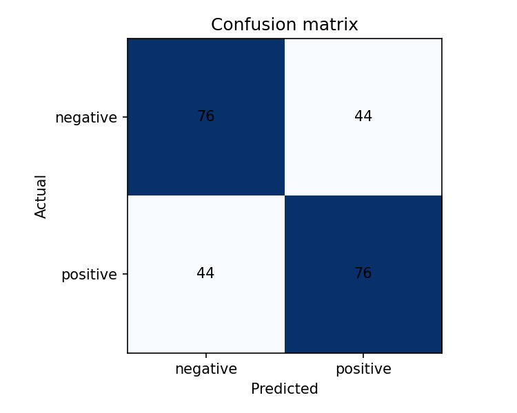

# A4-1: TF-IDF 영화 리뷰 검색과 분류

## 1. 구현 요약

이 프로젝트는 익명 **합성 영화 리뷰** 1,200개를 사용한다. 긍정·부정이 각각 600개이며, 실제 사용자의 리뷰가 아니라 `generate_data.py`가 고정 시드 42로 만든 문장이다. 각 문장의 주된 평가에 따라 레이블을 부여했고, 반대 평가도 섞었다. 데이터는 이 프로젝트에서 작성해 자유롭게 사용할 수 있으며 개인정보가 없다. 다만 템플릿과 어휘가 제한되어 실제 영화 리뷰 데이터셋을 활용하라는 과제 취지를 완전히 충족하지 못하며, 성능도 실제 서비스의 성능으로 해석할 수 없다. 공개 리뷰를 원한다면 [NSMC](https://github.com/e9t/nsmc)는 CC0로 배포되지만 원문에 실명 등이 포함될 수 있어 개인정보 검토 없이 사용하지 않았다.

- 정제·토큰화: 소문자로 바꾸고 `[가-힣a-z0-9]+`에 해당하는 연속 문자열을 토큰으로 추출한다. 구두점, 이모지, 낱자 한글, 다른 문자와 특수문자는 구분자로 처리한다. 영어와 숫자는 작품 관련 표기를 위해 남긴다. 빈 문서도 안전하게 0벡터가 된다.
- 불용어: `이, 그, 저, 것, 수, 정말, 너무, 그냥, 그리고, 하지만, 영화`. 문서 공통의 지시어·강조어·연결어를 줄이려 선택했다. 다만 `하지만` 제거는 문장 관계를 잃게 하며 실험상의 한계다. 부정어 `않았다`, `별로였다`는 감성에 중요하므로 보존한다. 동의어 치환은 별도 규칙을 만들지 않아 적용하지 않는다. 같은 뜻의 표현도 다른 토큰이 된다.
- 한국어는 조사와 어미가 단어에 붙으므로 공백에 가까운 이 방식에서 `연기가`와 `연기`가 다른 토큰이다. 형태소 분석은 공통 어근을 합쳐 검색 일치율을 높일 수 있으나 품사·문맥 오분석이 발생할 수 있다. 영어는 주로 공백과 구두점으로 단어를 구분할 수 있지만 굴절어와 축약형에는 추가 처리가 필요하다.
- 단어 수 벡터의 각 원소는 `tf(t,d) = count(t,d)`, `df(t) = 해당 단어가 등장한 학습 문서 수`, `idf(t) = log((1 + N)/(1 + df(t))) + 1`이다. `tf × idf`를 각 문서의 L2 노름으로 나누며, 영벡터는 그대로 둔다. TF는 문서 내 출현 빈도, IDF는 흔한 단어의 상대적 영향 감소를 나타낸다. NumPy로 직접 계산한다.
- 검색은 전체 문서에서 사전·IDF를 만들고 쿼리도 같은 변환을 적용한다. 코사인 유사도는 `q·d / (||q|| ||d||)`로 직접 계산한다. 0점 문서는 반환하지 않으므로 결과가 다섯 개 미만일 수 있다. 분류는 누수 방지를 위해 훈련 문서로만 사전과 IDF를 학습한다.

## 2. 검증 및 실험 결과

`python main.py --experiment` 실행 결과 (Python 3.9.6, NumPy 2.0.2, scikit-learn 1.6.1):

- 문서 1,200개, 계층화 분할 `random_state=42`, 훈련 960 / 테스트 240, 훈련 어휘 33개.
- scikit-learn `TfidfVectorizer(tokenizer=tokenize, token_pattern=None, lowercase=False, vocabulary=훈련_사전, smooth_idf=True, sublinear_tf=False, norm='l2', dtype=float64)`와 훈련 및 테스트 행렬 비교: 최대 오차 **1.1102230246251565e-16**, 평균 오차 **2.3553689862707314e-18**, 허용치 1e-6 통과. 같은 토큰화와 어휘를 사용한다.
- 분류: `LogisticRegression(solver='liblinear', max_iter=1000, random_state=42)`. 정확도 **0.6333**, macro F1 **0.6333**.
- 혼동 행렬 (행 실제, 열 예측): `[[76, 44], [44, 76]]`; 순서 부정(0), 긍정(1).



전체 오분류 목록 및 수치: [results/metrics.json](results/metrics.json). 아래는 실제 테스트 오분류다. 원인 설명은 모델 가중치의 인과적 증명이 아니라 문장 및 특성 표현에 근거한 해석이다.

| ID | 실제 → 예측 | 문장 | 가능한 원인 |
|---|---|---|---|
| review-0161 | 부정 → 긍정 | 끝까지 봤는데 전개 별로였다 또한 영상 인상적이었다 | 긍정·부정 단어가 동시에 등장하고 어느 평가가 주된 것인지 알 수 없다. |
| review-0775 | 부정 → 긍정 | 기대하고 봤는데 연기 만족스러웠다 하지만 액션 아쉬웠다 | 접속어가 제거되어 대조와 최종 평가의 관계가 사라진다. |
| review-0426 | 긍정 → 부정 | 다시 봤는데 음악 인상적이었다 그리고 결말 마음에 들지 않았다 | 부정구가 긍정 평가와 함께 등장하고 주된 평가를 구분하지 못한다. |
| review-0323 | 부정 → 긍정 | 끝까지 봤는데 스토리 인상적이었다 하지만 결말 실망스러웠다 | 긍정과 부정 표현의 결합 순서 및 대조를 놓친다. |
| review-0175 | 부정 → 긍정 | 끝까지 봤는데 대사 좋았다 반면 음악 실망스러웠다 | `좋았다`와 `실망스러웠다`가 함께 있으나 대상과 평가의 연결이 사라진다. |

## 3. 한계와 개선 방향

BoW는 순서를 무시한다. 예를 들어 `고양이가 쥐를 잡았다`와 `쥐를 고양이가 잡았다`는 같은 벡터다. `배가 고프다`와 `배를 타다`의 어근 `배`처럼 동음이의어도 단어만으로 뜻을 구분하기 어렵다. 이 구현에서는 조사까지 함께 토큰화하기 때문에 실제로 `배가`와 `배를`도 각각 다른 단어가 된다. 부정 표현, 반어, 유사어, 문맥을 제대로 다루지 못한다. 또한 이 합성 데이터는 제한된 템플릿과 생성 규칙 때문에 결과가 실제 사용자 리뷰에 일반화된다는 근거가 되지 않는다. 혼합 감성 문장의 레이블은 생성 과정의 주된 평가를 기준으로 하며, 그 우선순위가 문장에 명시되지 않아 사람에게도 모호할 수 있다.

후속으로 개인정보 및 사용 조건을 확인한 실제 리뷰에서 별도 훈련·테스트를 구성하고, 형태소 분석과 부정어 보존, 단어/문자 n-gram, 문맥 기반 임베딩을 같은 분할에서 비교한다. 실제 검색 평가는 관련성 정답과 별도 쿼리 집합을 만들어 Precision@5 등을 측정한다.

## 실행 방법

Python 3.10 이상 권장. 터미널에서 이 폴더로 이동 후:

```bash
python -m venv .venv
source .venv/bin/activate  # Windows: .venv\Scripts\activate
pip install -r requirements.txt
python main.py --query "연기 감동" --topk 5
python main.py --experiment
```

검색 출력 예시 (동점은 ID 순):

```text
[0.4457] review-1041 처음 봤는데 스토리 어색했다 그리고 연기 별로였다
[0.4452] review-0377 처음 봤는데 연기 재미있었다 하지만 액션 별로였다
[0.4441] review-0709 주말에 봤는데 연기 어색했다 하지만 액션 아쉬웠다
[0.4440] review-0001 극장에서 봤는데 스토리 어색했다 그리고 연기 인상적이었다
[0.4440] review-0025 극장에서 봤는데 연기 어색했다 하지만 스토리 인상적이었다
```

`감동`은 이 말뭉치에 없으므로 점수에는 `연기`만 기여한다. `search(query, topk=5)`는 `(score, doc_id, snippet)` 목록을 반환한다. 실험은 `results/metrics.json`, `results/confusion_matrix.png`를 덮어쓴다. 데이터를 다시 생성하려면 `python generate_data.py`를 실행한다.
