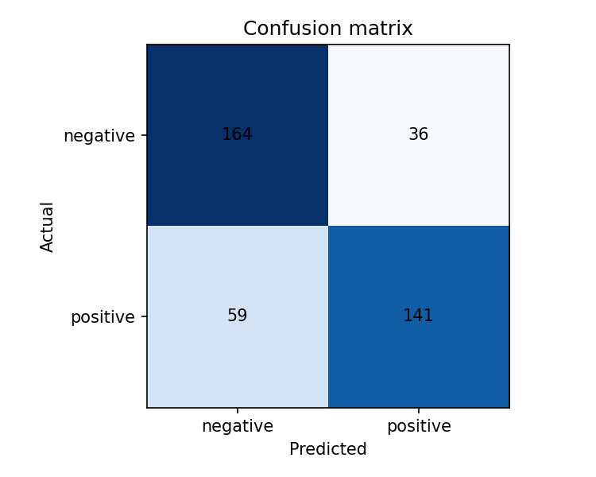

# A4-1: 지능형 문서 검색 및 분류 시스템 (TF-IDF)

NumPy만을 사용하여 TF-IDF 벡터화와 코사인 유사도 기반 문서 검색을 직접 구현하고, `scikit-learn`과의 수치 검증 및 감성 분류 실험을 수행한 프로젝트입니다.  
과제 수행은 **Iteration 1(합성 더미 데이터로 파이프라인 검증)** → **Iteration 2(실제 NSMC 한국어 영화 리뷰 데이터셋 적용 및 분석)**의 2단계로 진행했습니다.

---

## 1. 구현 요약

### 1.1 아키텍처 및 모듈화 설계
단일 스크립트(`main.py`)에 모든 로직이 섞여 있으면 특정 단계(예: 토큰화 교체, 다른 검색 모델 추가)를 수정하거나 단위 테스트를 작성하기 어렵습니다. 이를 해결하기 위해 역할을 4개 모듈과 1개 CLI 진입점으로 분리했습니다.

| 모듈 | 역할 | 분리 이유 (유지보수·테스트 용이성) |
| :--- | :--- | :--- |
| `preprocess.py` | 텍스트 정제, 토큰화(`tokenize`), 불용어 제거, CSV 로드(`load_data`) | 형태소 분석기 도입이나 불용어 변경 시 벡터화 코드를 건드리지 않고 독립 교체·테스트 가능 |
| `tfidf.py` | NumPy 기반 `Tfidf` 클래스(`fit`, `_counts`, `transform`), 코사인 유사도(`cosine`) | 핵심 수학 연산을 분리해 `scikit-learn`과의 수치 검증 단위 테스트가 용이 |
| `search.py` | 전체 말뭉치 색인 및 Top-K 검색(`search`) | 검색 정렬/동률 처리 정책 및 향후 역색인(Inverted Index) 도입을 독립적으로 개선 가능 |
| `experiment.py` | `scikit-learn` 오차 검증, Train/Test 분할, 분류 학습·평가 및 시각화(`experiment`) | 실험 파이프라인과 아티팩트(`metrics.json`, `confusion_matrix.png`) 생성을 서비스 코드와 분리 |
| `main.py` | CLI 인자 파싱(`--query`, `--topk`, `--experiment`) 및 `search` 함수 재노출 | 실행 인터페이스 일관성 유지 |

### 1.2 데이터셋 구성 및 타 데이터 적용 규격
* **Iteration 1 (합성 더미 데이터)**: `generate_data.py`로 생성한 1,200건(긍정 600 / 부정 600, 어휘 33개)으로 파이프라인 정상 동작을 우선 검증했습니다. (결과 백업: `results/iter1/`)
* **Iteration 2 (실제 NSMC 데이터셋)**: `prepare_nsmc.py`를 통해 공개 [NSMC(네이버 영화 리뷰)](https://github.com/e9t/nsmc)(라이선스: CC0 1.0 Public Domain) `ratings_test.txt`에서 결측치(빈 문장, 토큰 2개 미만)와 개인정보 패턴(이메일, 전화번호 형식)을 필터링한 뒤, 고정 시드(`42`)로 **긍정 1,000건 / 부정 1,000건 총 2,000건**을 균형 샘플링하여 `data/reviews.csv`를 구성했습니다. (결과 백업: `results/iter2/`, 최신 기본 결과: `results/`)
* **다른 CSV 데이터셋 적용 조건**:
  * **필수 컬럼**: `id`(고유 식별자), `text`(문서 본문), `label`(정수형 클래스 라벨, 최소 2개 이상 카테고리)
  * **인코딩 및 규모**: UTF-8 인코딩, 최소 500건 이상(계층화 분할 및 어휘 확보 목적)
  * **사전 처리**: 결측치(`null`/빈 문자열) 제거 및 개인정보 비식별화 확인 필수

### 1.3 전처리 및 불용어 설계 근거
* **텍스트 정제 및 토큰화 (`preprocess.py`)**:
  * 영문 대소문자 통일을 위해 `text.lower()`를 적용하고, 정규표현식 `[가-힣a-z0-9]+`로 완성형 한글·영문·숫자 연속 문자열만 추출했습니다.
  * 구두점(`!`, `?`, `...`), 낱자 자모(`ㅋㅋ`, `ㅎㅎ`), 이모지는 구분자로 처리해 노이즈를 줄이되, 작품명·평점 표기 등에 쓰이는 영문과 숫자는 보존했습니다.
  * 한국어 형태소 분석기(KoNLPy 등) 설치 없이 순수 Python 환경에서 재현 가능하도록 정규식 기반 토큰화를 채택했습니다. 이로 인해 `"연기"`와 `"연기가"`가 서로 다른 토큰으로 분리되는 한계가 있으며, 이는 3장에서 분석합니다.
* **불용어 (`STOPWORDS`)**:
  * `{'이', '그', '저', '것', '수', '정말', '너무', '그냥', '그리고', '하지만', '영화'}` (11개)
  * **선정 근거**: 지시어(`이/그/저/것`), 과도한 강조 부사(`정말/너무/그냥`), 도메인 공통어(`영화`), 일반 접속사(`그리고/하지만`)가 TF-IDF 가중치를 독점하거나 노이즈가 되는 것을 줄이기 위해 제외했습니다. 반면 `"못"`, `"아니"` 등 부정 표현은 감성 판별에 치명적이므로 보존했습니다.
  * **트레이드오프**: `"하지만"`을 제거함으로써 역접 문장의 대조 단서가 사라지는 부작용이 확인되었으며, 감성 분석 정확도를 높이려면 접속사는 유지하는 편이 유리합니다.

### 1.4 TF-IDF 수식 및 행렬 구조 (`tfidf.py`)
1. **TF-IDF 행렬 구조**: `transform()`은 **`(문서 수 × 어휘 수)`** 크기의 2차원 행렬을 생성합니다. 각 **행(Row)**은 하나의 문서(리뷰)를, 각 **열(Column)**은 `fit()` 단계에서 구축한 어휘 사전(`vocabulary`)의 고유 단어를 의미하며, 각 원소는 해당 문서 내 단어의 정규화된 중요도입니다.
2. **TF (단어 빈도)**: $\text{tf}(t, d) = \text{count}(t, d)$ — 문서 $d$ 내에 단어 $t$가 등장한 횟수(Raw Count)를 그대로 사용합니다.
3. **IDF (역문서 빈도)와 로그·스무딩 이유**:
   $$\text{idf}(t) = \log\left(\frac{1 + N}{1 + \text{df}(t)}\right) + 1$$
   * **역수 적용**: 전체 문서 수 $N$ 대비 해당 단어가 등장한 문서 수 $\text{df}(t)$가 적을수록(희귀할수록) 높은 가중치를 부여합니다.
   * **$\log$ 적용 이유**: 문서 수가 커질수록 빈도 비율의 차이가 수백~수천 배로 폭증하는 것을 막고, 스케일을 완만하게 축소해 극단적인 가중치 왜곡을 방지합니다.
   * **`+1` 스무딩 이유**: 분모·분자에 `1`을 더해 0으로 나누는 오류를 방지하고, 마지막에 `+1`을 더해 모든 문서에 등장하는 단어($\text{df}(t) = N$)라도 IDF가 `0`이 되어 완전히 소실되지 않도록 합니다.
4. **L2 정규화와 유클리드 거리 대비 장점**:
   $$\mathbf{v}_{\text{norm}} = \frac{\mathbf{v}}{\|\mathbf{v}\|_2} \quad (\|\mathbf{v}\|_2 = 0\text{이면 영벡터 유지})$$
   * **정규화 필요성**: 긴 문서는 단어 출현 횟수가 많아 벡터 크기(노름)가 커지므로, L2 정규화를 통해 모든 문서 벡터의 길이를 `1`로 맞추어 문서 길이 편향을 제거합니다.
   * **유클리드 거리와의 차이**: 유클리드 거리는 두 벡터 끝점의 직선 거리를 재므로 단어 빈도 총량(문서 길이)에 민감하지만, L2 정규화된 벡터 간의 **코사인 유사도**($\frac{\mathbf{q} \cdot \mathbf{d}}{\|\mathbf{q}\| \|\mathbf{d}\|}$)는 두 벡터가 이루는 **각도(방향, 즉 단어 구성 비율)**만 비교하므로 길이가 다른 문서 간 유사도 측정에 훨씬 적합합니다.

### 1.5 검색 및 분류 파이프라인 (`search.py`, `experiment.py`)
* **문서 검색**: 전체 문서를 기준으로 사전과 IDF를 구축한 뒤, 쿼리를 동일하게 벡터화하여 코사인 유사도를 계산합니다. 유사도 내림차순으로 정렬하며, **동률(점수가 동일한 경우)일 때는 문서 `id` 오름차순**을 우선순위로 사용합니다. 유사도가 `0`인 문서는 제외하므로 반환 개수가 `topk`보다 적을 수 있습니다.
* **문서 분류**: 데이터 누수(Data Leakage)를 방지하기 위해 Train/Test를 `8:2` 계층화 분할(`random_state=42`)한 뒤, **훈련 데이터(`1,600건`)만으로** 어휘 사전과 IDF를 학습(`fit`)하여 Logistic Regression(`solver='liblinear'`, `max_iter=1000`)을 학습합니다.

---

## 2. 검증 및 실험 결과

### 2.1 Iteration 비교 (합성 데이터 vs 실제 NSMC)

| 구분 | Iteration 1 (합성 데이터) | Iteration 2 (NSMC 실제 리뷰) |
| :--- | :---: | :---: |
| **문서 수 (Train / Test)** | 1,200 (960 / 240) | **2,000 (1,600 / 400)** |
| **추출 어휘 수 (`features`)** | 33 | **8,558** |
| **sklearn 최대 오차 (`max_error`)** | `1.11e-16` | **`2.22e-16`** (통과 기준 `1e-6` 이내) |
| **sklearn 평균 오차 (`mean_error`)** | `2.36e-18` | **`9.61e-21`** |
| **정확도 (Accuracy)** | 0.6333 (63.33%) | **0.7625 (76.25%)** |
| **Macro F1-Score** | 0.6333 | **0.7617** |

### 2.2 Scikit-learn 검증 로그 (Iteration 2)
* **사용한 `sklearn` 설정**:
  `TfidfVectorizer(tokenizer=tokenize, token_pattern=None, lowercase=False, vocabulary=tfidf.vocabulary, smooth_idf=True, sublinear_tf=False, norm='l2', dtype=np.float64)`
* **실행 출력 요약**:
  ```json
  {
    "documents": 2000,
    "train": 1600,
    "test": 400,
    "features": 8558,
    "max_error": 2.220446049250313e-16,
    "mean_error": 9.613749125803693e-21,
    "accuracy": 0.7625,
    "macro_f1": 0.76171216083175,
    "confusion_matrix": [[164, 36], [59, 141]]
  }
  ```
* **검증 결과**: 직접 구현한 NumPy TF-IDF와 `scikit-learn` 결과의 최대 오차가 `2.22e-16`으로 허용 오차(`1e-6`) 이내임을 확인했습니다.

### 2.3 분류 성능 지표 해석 및 혼동 행렬
* **정확도(`0.7625`) 및 Macro F1(`0.7617`)**: 테스트셋 400건 중 305건을 올바르게 분류했습니다. 긍정·부정 클래스 간 균형 잡힌 성능(F1과 Accuracy가 유사)을 보이지만, 실제 리뷰의 띄어쓰기 오류·신조어·반어법 등으로 인해 약 23.75%의 오차가 발생했습니다.
* **혼동 행렬** (`행: 실제`, `열: 예측` | `0: negative`, `1: positive`):
  * 실제 부정 중 164건 정답, 36건을 긍정으로 오분류
  * 실제 긍정 중 141건 정답, 59건을 부정으로 오분류 (긍정 리뷰를 부정으로 잘못 예측하는 비율이 상대적으로 높음)



### 2.4 오분류 사례 5건 원인 분석 (`results/metrics.json`)

| ID | 실제 → 예측 | 리뷰 원문 | 오분류 원인 분석 (BoW 및 토큰화 한계) |
| :--- | :---: | :--- | :--- |
| `8934044` | 부정(0) → 긍정(1) | `명성만 믿고 보기엔 너무아깝다...` | 불용어(`너무`)와 달리 띄어쓰기 없이 붙은 `"너무아깝다"`가 하나의 희귀 토큰으로 처리되어 `"아깝다"`의 부정 신호를 학습하지 못함(OOV). |
| `2760380` | 부정(0) → 긍정(1) | `좋은 배우들로 웃음~ or 감동~ 하나도 못 건진..딱 제목과 걸맞는 수준의 영화^-^;;` | `"좋은"`, `"웃음"`, `"감동"` 등 긍정 단어 빈도가 높아 긍정 점수가 올라갔으나, 뒤의 `"못 건진"` 부정 수식 관계와 이모티콘(`^-^;;`)의 비꼬는 문맥을 BoW가 반영하지 못함. |
| `8040816` | 부정(0) → 긍정(1) | `역시 내 포인트가 아깜네` | `"아깝네"`의 구어체 오타(`아깜네`)가 훈련 어휘에 없어 미등록 단어(OOV)로 무시되면서 핵심 부정 단서가 소실됨. |
| `9404969` | 긍정(1) → 부정(0) | `반고흐의 죽음까지 그린영화.다큐같기도 하고 배경도 아름답고고흐는 괴짜가 아니예욥` | 띄어쓰기 누락(`그린영화`, `아름답고고흐는`)으로 공백 기반 정규식이 `"아름답고"` 같은 긍정 어근을 추출하지 못함. |
| `5386163` | 긍정(1) → 부정(0) | `이명세 감독을 처음 알게된 영화` | 명시적인 긍정 형용사(`좋다`, `최고`) 없이 맥락적 호평을 서술해 단어 빈도만으로는 긍정 성향을 포착하기 어려움. |

---

## 3. 한계와 개선 방향

### 3.1 BoW(Bag of Words) 방식의 근본적 한계
1. **어순 및 문법 구조 무시**:
   * 예: `"고양이가 쥐를 잡았다"` vs `"쥐가 고양이를 잡았다"` → 단어 구성과 빈도가 완전히 같아 동일한 TF-IDF 벡터를 생성합니다.
   * 감성 리뷰에서도 `"배우 연기는 좋았으나 스토리는 최악"`과 `"스토리는 좋았으나 배우 연기는 최악"`의 뉘앙스 차이를 구분하지 못합니다.
2. **동음이의어·다의어 구분 불가**:
   * 예: `"배가 고프다"`, `"배를 타다"`, `"배 과수원"`에서 어근 `'배'`가 서로 다른 의미를 가지지만 BoW에서는 동일한 차원으로 취급됩니다. (현재 정규식 토크나이저는 조사까지 붙어 `'배가'`, `'배를'`로 오히려 파편화되는 문제도 동반합니다.)
   * 예: `"사과를 먹었다"`(과일)와 `"진심으로 사과했다"`(사죄) 역시 문맥이 없으므로 다의어 의미를 분리할 수 없습니다.
   * **해결 접근**: 주변 단어의 문맥에 따라 같은 단어라도 다른 벡터를 생성하는 **문맥 임베딩(BERT, RoBERTa 등 Transformer 기반 모델)**이나 **단어 의미 중의성 해소(WSD)** 기법을 적용해야 합니다.

### 3.2 대규모 데이터(100만 건 이상) 확장 시 병목 및 대응 방안
현재 `tfidf.py`의 구현은 소규모 실험용으로 설계되어 있어 문서 수가 100만 건 이상으로 커지면 두 가지 심각한 병목이 발생합니다.
1. **메모리 폭발 (OOM)**: `np.zeros((N, V), dtype=np.float64)`는 대부분의 값이 `0`인 밀집 행렬(Dense Matrix)을 메모리에 올립니다. 문서 `1,000,000 × 어휘 100,000`이면 약 800GB의 RAM이 필요해 실행이 불가능합니다.
   * **대응**: 0이 아닌 값의 위치와 수치만 저장하는 **희소 행렬(Sparse Matrix, CSR/CSC)** 구조로 전환하고, 학습·변환을 **배치(Batch) 단위** 또는 분산 처리로 수행해야 합니다.
2. **검색 시간 복잡도 ($O(N \cdot V)$)**: `search()` 호출 시마다 전체 문서를 재학습하고 모든 문서 벡터와 내적을 계산합니다(전체 스캔).
   * **대응**: `단어 → [문서 ID 목록]` 형태의 **역색인(Inverted Index)**을 구축해 쿼리 단어가 포함된 후보 문서만 빠르게 조회하고, 사전 계산된 문서 벡터와 어휘 사전을 디스크/메모리에 캐싱해야 합니다.

### 3.3 재구현 시 개선 아이디어 및 정량 평가 방안
* **모델·전처리 개선**:
  * 한국어 형태소 분석기(Kiwi, Okt 등) 도입으로 조사/어미 분리 (`"아름답고고흐는"` 문제 해결)
  * 단어 1개(Unigram) 대신 2~3단어 묶음(**N-gram**)을 추가해 `"못 건진"`, `"시간 아깝다"` 등 복합 표현 포착
  * **BM25** 랭킹 알고리즘 도입으로 문서 길이 보정 및 TF 포화(Saturation) 효과 반영
* **검색 품질 정량 평가 지표 도입**:
  * 현재는 검색 결과의 정성적 확인만 가능하므로, 쿼리별 관련 문서 정답셋(Relevance Judgment)을 구축한 뒤 **Precision@K**, **Recall@K**, **MAP(Mean Average Precision)**, **NDCG(Normalized Discounted Cumulative Gain)** 지표로 개선 전후의 검색 품질을 정량 비교해야 합니다.

---

## 4. 실행 방법

Python 3.10 이상 권장 (본 실험은 Python 3.9.6, NumPy 2.0.2, scikit-learn 1.6.1 환경에서 검증되었습니다).

### 1) 가상환경 생성 및 의존성 설치
```bash
python3 -m venv .venv
source .venv/bin/activate  # Windows: .venv\Scripts\activate
pip install -r requirements.txt
```

### 2) 문서 검색 실행 (안 A: CLI / 안 B: 함수)
```bash
python3 main.py --query "연기 감동" --topk 5
```
예시 출력:
```text
[0.3554] 133178 최고의 가족영화 감동 찡~ ^^
[0.2962] 9131113 이런 영화를 내가 왜 이제 봤을까... 정말 감동 그 자체인 영화...
[0.2920] 8704698 음...뭐지..연기..ㅎㅎ
[0.2648] 527395 일글런드 연기 지겹다
[0.2429] 275937 제임스 우즈 연기 최고.
```
* Python 코드 내에서 호출 시 `from search import search` 또는 `from main import search`로 `search(query: str, topk: int = 5) -> list[tuple[float, str, str]]` 시그니처를 사용할 수 있습니다.

### 3) TF-IDF 검증 및 분류 실험 실행
```bash
python3 main.py --experiment
```
실행 시 `results/metrics.json`과 `results/confusion_matrix.png`가 최신 결과로 갱신됩니다.

### 4) 데이터셋 재생성 (선택)
* 합성 더미 데이터(Iteration 1): `python3 generate_data.py`
* NSMC 샘플링(Iteration 2): `data/nsmc_ratings_test.txt` 위치 후 `python3 prepare_nsmc.py`
